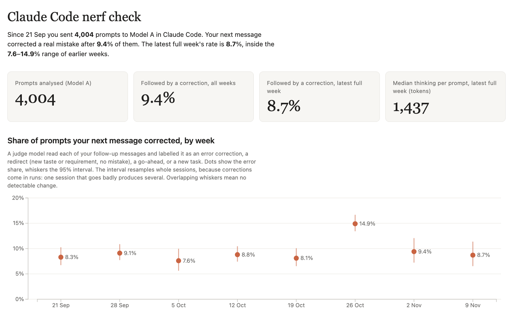
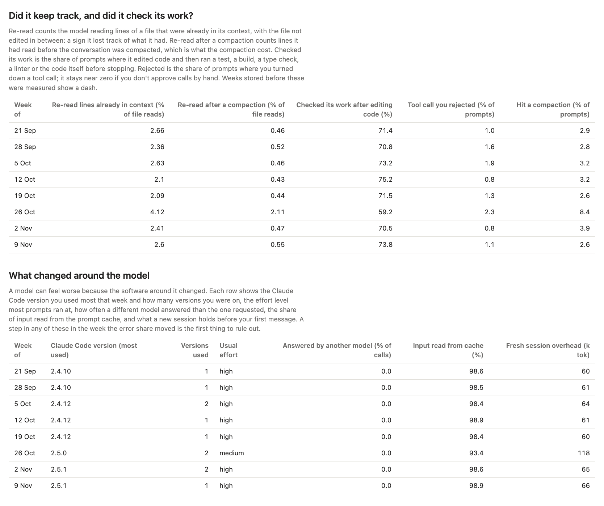
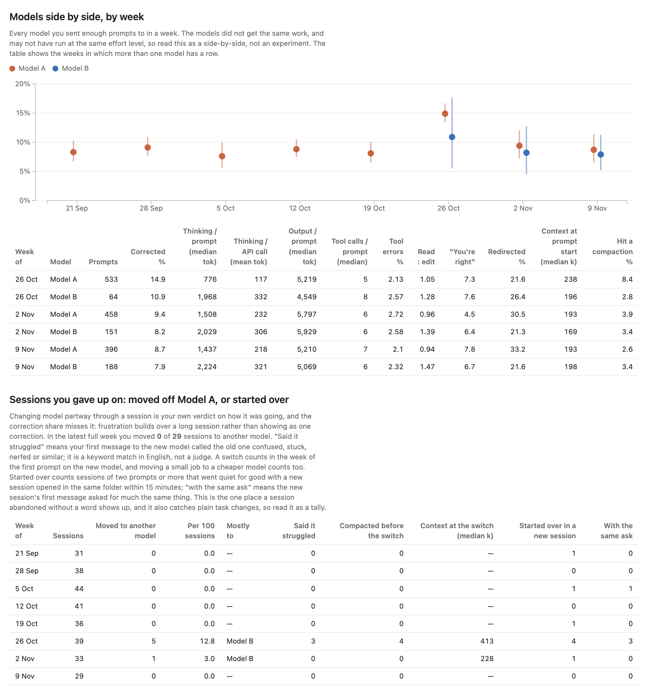
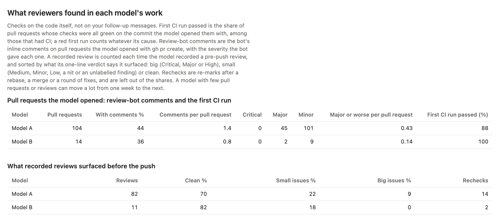

# Nerf check

Did the model get worse, or was it a bad week?

A Claude Code skill that answers from your own work instead of from memory: every prompt you typed, what the model
did with it, and whether your next message had to correct it. It reads your local Claude Code transcripts, has a cheap
model label each of your follow-up messages (correction, redirect, go-ahead, new task), and builds a week-by-week
dashboard.

Built by [Rig Labs](https://riglabs.ai/).

<picture>
  <source media="(prefers-color-scheme: dark)" srcset="docs/screenshots/overview-dark.png">
  
</picture>

<sub>Screenshots show made-up [sample data](docs/sample), not measurements of any model.</sub>

## Install

Pick one; they all install the same skill.

**Ask Claude.** Paste this into Claude Code:

```
Install the nerf-check skill from https://github.com/rig-xyz/nerf-checker: copy its skills/nerf-check folder to ~/.claude/skills/nerf-check. Then run a nerf check.
```

**One command.** With the [skills CLI](https://github.com/vercel-labs/skills):

```
npx skills add rig-xyz/nerf-checker -g -a claude-code
```

`-g` installs it for every project; leave it out to install into the current project only.

**As a plugin.** In Claude Code:

```
/plugin marketplace add rig-xyz/nerf-checker
/plugin install nerf-check@nerf-checker
```

It only works in Claude Code (the terminal or the desktop app's Code tab), since it reads Claude Code's local
transcripts.

Then ask Claude: "run a nerf check", or "did Opus get worse this month?". The first run reads every transcript still
on disk and tells you how many prompts it will label before it starts. After that it offers to run weekly.

## What you get

- **Share of prompts your next message corrected**, per week, with a 95% interval that resamples whole sessions.
- **How the model worked**: thinking tokens per prompt, tool calls, tool and edit failures, reads per edit, context
  size, compactions.
- **Did it keep track, and did it check its work**: how often it re-read lines it already had, how often a compaction
  made it read them again, and how often it ran a test or build after editing code.
- **What changed around the model**: Claude Code version, effort level, cache hits, session overhead, and any call
  answered by a different model than the one requested.
- **Models side by side** for any week you used more than one.
- **Sessions you gave up on**: moved to another model mid-conversation, or started over in a new session.
- **What happened to its pull requests**: whether the first CI run passed, review-bot comments if you use CodeRabbit,
  and your team's recorded pre-push reviews if you have such a command. Each is optional; CI needs only `gh`.
- **A split by effort level and by context size**, the two things that most often explain a "nerf".

## What it looks like

In the sample, the week of 26 October looks like a nerf. The harness table shows what happened: a client release
that week lowered the effort level and doubled the context a fresh session starts with.

<picture>
  <source media="(prefers-color-scheme: dark)" srcset="docs/screenshots/tracking-and-harness-dark.png">
  
</picture>

Models side by side, and the sessions you gave up on:

<picture>
  <source media="(prefers-color-scheme: dark)" srcset="docs/screenshots/models-and-sessions-dark.png">
  
</picture>

What happened to the pull requests each model opened:

<picture>
  <source media="(prefers-color-scheme: dark)" srcset="docs/screenshots/reviews-dark.png">
  
</picture>

To see the page yourself before running anything:

```
NERF_CHECK_HOME=docs/sample python3 skills/nerf-check/scripts/preview.py
open docs/sample/preview.html
```

## Privacy

- The scripts are plain Python with no packages. They read `~/.claude/projects` and write to `~/.claude/nerf-check`.
  They send nothing anywhere.
- The stored history is numbers per prompt. Prompt text is never stored. The two snippets the judge reads (the last
  500 characters of a reply, the first 300 of your next message) are deleted once that prompt is labelled.
- Two things leave your machine. The judge snippets go to a model through subagents of your own Claude session, the
  same place your Claude Code traffic already goes. The dashboard receives eight small CSVs of weekly aggregates.
- Pull-request comments and CI check results are read from GitHub with your own `gh` login, read-only.

## What it can and can't tell you

It measures your experience, not the model in isolation. The error share moves with how hard the week's work was and
how patient you were. Read one week against the range of the others, and treat overlapping intervals as no detectable
change. A fixed benchmark rerun on a schedule answers "did the model change"; this answers "did my work with it
change". [`references/metrics.md`](skills/nerf-check/references/metrics.md) has every column and
its limits.

The judge is a model too, so each label records which judge model and prompt produced it, each run re-judges a sample
to measure the judge's consistency, and the report says when the judge changed.

## Configuration

Optional, in `~/.claude/nerf-check/config.json`. Every key and its default is documented in
[`scripts/common.py`](skills/nerf-check/scripts/common.py). The ones most people set:

| Key | What it does |
|---|---|
| `primary_model` | Model id the headline follows. Default: the model with the most prompts. |
| `automated` | Regex for prompts no person typed (your scripted runs), so they are left out. |
| `verify` | Regex for your own check commands, counted as checking the work after an edit. |
| `ci` | `false` to skip reading each pull request's first CI run. |
| `review_bot` | GitHub login of your review bot. Default `coderabbitai[bot]`. |
| `review_mark` | Regex for a command that records a pre-push review with a one-line verdict. |
| `keep_text` | Keep the judge snippets after labelling, to re-judge old weeks later. Default off. |

## Requirements

Claude Code with subagents, Python 3.9 or later, and optionally `gh` for the pull-request signals. The dashboard is a
hosted Claude artifact; without one, `scripts/preview.py` writes the same page as a local HTML file.

It depends on Claude Code's transcript format, which is not documented. Written against Claude Code 2.1.247 to
2.1.325; the extractor warns when the fields it needs stop appearing.

## Development

```
python3 tests/test_pipeline.py
```

Runs the whole pipeline on made-up transcripts in a temp folder. No packages, no network.

The skill lives in `skills/nerf-check`: `SKILL.md` is what Claude follows, `scripts/` does the
counting, `references/` explains the numbers, and `assets/` holds the dashboard page and the judge prompt. Changing
the judge prompt starts a new series, since labels are only comparable under the same instructions.

## Licence

Apache-2.0, © 2026 [Rig Labs](https://riglabs.ai/). See [LICENSE](LICENSE) and [NOTICE](NOTICE).
